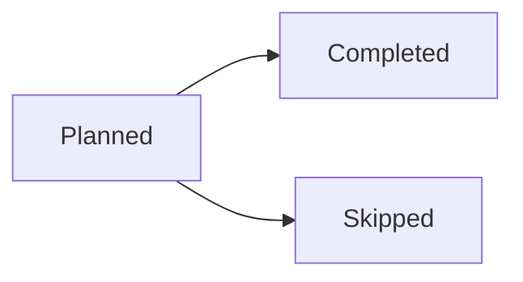

# Writing a run's report

When you run as a job, the owner doesn't see the prompt or your steps: they see a page with
the report's title and the report. Publish it with the `report` command:

    report --title "Prices: 2 of 14 dropped" report.md     # or pipe it in: … | report

Publish again to replace it (a long run can keep the owner current). If you never publish,
your final message becomes the report, so still end well.

## What goes in it

- **Lead with the result**: the one or two sentences the owner needs, in plain words. The
  title says it too ("Backups: all 7 healthy", "3 new invoices, 1 overdue"), not the job's name.
- **Then the data, if any**: a small table, or a chart when there are 3+ values that compare or
  change (see the format below). Exact numbers from the source; never round or invent.
- **Then what needs doing, if anything**, and links: files in Files
  (`/#/v/files#p=<url-encoded path>`), apps (`/#/v/<name>`), pages, pull requests.
- **Not the process.** No "I ran…, then I checked…". No headings like "Summary" for a three-line
  report. Start any headings at `##` (the page shows the title).
- **Big or ongoing work** (a Sprite job, a long extraction): report where it stands (what started,
  how far along, what's next, where the output will land) and publish again when it changes.
- Short is good. A healthy routine run can be one sentence.
- Never put keys, tokens or passwords in a report.

## The format (Rollmark)

Rendered by Springroll with the owner's theme. Follow this exactly:

Never wrap your whole response in a code fence, or the visual blocks inside it will not render.

In addition to ordinary Markdown (headings, paragraphs, lists, tables, bold text), you may include two kinds of visual blocks as fenced code blocks:

## Chart blocks

Use a ```chart fenced block for quantitative data — values that compare or change. The payload starts with the chart type on its own line, then optional `key: value` lines, then a pipe-separated data table:

```chart
line
title: Daily visitors
summary: Daily visitors grew steadily from 1,240 to 1,510 over three days.

date | Visitors
2026-08-01 | 1240
2026-08-02 | 1380
2026-08-03 | 1510
```

Rules:

- The first line is the chart type: `line` (trends), `bar` (category comparisons), `area` (magnitude over time), `scatter` (relationship between two numeric measures), or `pie` (shares of a whole).
- The first table column is the x-axis; every additional column is a series (1–8). Column headers become the labels.
- The table's first row is ALWAYS a header row naming the columns (e.g. `plan | Subscribers`) — even for pie charts. Never start the table with a data row.
- Each data row is ONE x-axis entry — one date or one category. For category comparisons the categories go down the first column, one per row — never across the header.
- Write dates as ISO 8601 (`2026-08-01`); the axis becomes a time axis automatically.
- Series cells are numbers; leave a cell empty for a missing value. Pie charts take exactly one value column; scatter needs numeric x values.
- Add `stack: true` for stacked bars or areas (parts of a whole over the x-axis).
- Always include a `summary:` line — one or two sentences stating what the chart shows, consistent with the data. It is shown when the chart itself cannot be.
- CRITICAL: use the exact numbers from the source data. Never round, estimate, invent, or omit data points. A chart that alters the data is worse than no chart.
- Do not add colors, sizes, fonts, or styling — presentation is handled by the renderer.

## Mermaid blocks

Use a ```mermaid fenced block for relationships and structure — workflows, dependencies, sequences, states, schedules, timelines. Prefer stable Mermaid diagram types (flowchart, sequenceDiagram, stateDiagram, gantt, timeline, pie).



## Choosing between them

- Chart: "how do these quantities compare or change?"
- Mermaid: "how are these things connected or ordered?"
- Neither: if the data is a handful of values best stated in a sentence or a small Markdown table, do that instead.
- HARD RULE: never chart one or two values — a single metric, a total, or a used-vs-capacity pair belongs in prose (e.g. "412 GB of 500 GB, 82%"), not a chart. A chart needs at least three data points AND a comparison or trend worth seeing. When in doubt, write prose; a report with no chart is better than a report with a pointless one.
